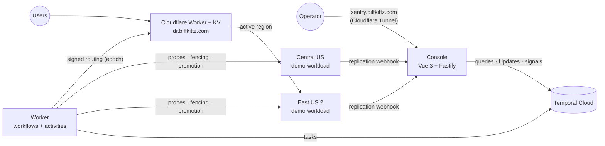

# Failover Sentry

**A multi-region disaster-recovery orchestrator built on Temporal (TypeScript SDK), with a Vue 3 console, running on
Azure Container Apps and Cloudflare.**

Automated failover is easy to get wrong: two primaries (split brain), traffic sent to a database that isn't writable
yet, a lost confirmation that leaves a failover hanging, a revert that makes things worse. The sentry is a durable,
autonomous workflow that watches every region, decides when to fail over, moves the primary database and the edge
routing in a safe order, waits for downstream confirmations with durable timeouts, verifies the result through the
edge, and safely reverts if anomalies appear. Every decision and operator action is in its Temporal history.



## What it demonstrates

| Requirement | How |
| --- | --- |
| **Child workflows for regional isolation** | The orchestrator (`failoverSentryWorkflow`) supervises one `monitorRegionChild` per region. Each owns its polling loop (local-activity probes, rolling-window evaluation, continue-as-new) and signals the parent only when something changes, so the parent aggregates verdicts cleanly. |
| **Cancellation scopes for rapid interruptions** | "Normal operations" (the monitors, the reconciler and their timers) run in one cancellable scope. An automatic decision or the emergency failover **Update** cancels it, and the sentry switches to the failover branch with no dangling timers. Failovers run in their own scope that an operator can abort mid-step; compensation and alerts run in non-cancellable scopes. |
| **External signals and webhook gateways** | The promoting region posts a signed `replication.promotion.completed` webhook to the console's gateway, which signals `replicationComplete`. The failover waits with `condition()` and a **durable timeout**: on expiry it checks directly, then raises an automated alert and waits for an operator decision (keep waiting, retry forced, abort) before reverting. |
| **No split brain** | One decider, drain → fence → promote → verify → route ordering, epoch fencing tokens enforced by the databases and the edge, STONITH via Azure Resource Manager, and a reconciler that fences stale primaries. |
| **Safe reverts** | A saga: a stabilization watch probes through the edge, and anomalies, failures or aborts trigger compensation that restores the old primary under a new epoch (or keeps the target if the old one can't serve). |

## Quick start (local, no cloud)

```bash
docker compose up --build
```

Open http://localhost:8080 (console, dev sign-in) and http://localhost:8233 (Temporal UI). Then take East US 2 down
from its region page and watch the sentry fail over, fence it, wait for the replication webhook, switch the edge and
stabilize. More in [docs/DEVELOPMENT.md](docs/DEVELOPMENT.md).

## Repository

| Path | What |
| --- | --- |
| [`apps/worker`](apps/worker) | Temporal worker: the sentry and monitor workflows, activities, adapters (regions, edge, Azure, email). |
| [`apps/console`](apps/console) | The console: Fastify server (GitHub OAuth, SSE, Updates, webhook gateway) and the Vue 3 app. |
| [`apps/regional-app`](apps/regional-app) | The protected demo workload with a simulated primary/replica database and chaos switches. |
| [`apps/edge-router`](apps/edge-router) | The Cloudflare Worker that routes the protected service to the active region. |
| [`packages/contracts`](packages/contracts) | Shared types, Temporal message definitions, configuration schema, request signing. |
| [`infra`](infra) | Terraform for Azure and Cloudflare (modules, mocked tests, environments). |
| [`docs`](docs) | [Architecture](docs/ARCHITECTURE.md) · [Workflows](docs/WORKFLOWS.md) · [Deployment](docs/DEPLOYMENT.md) · [Development](docs/DEVELOPMENT.md) |

## Stack

TypeScript (strict) on Node.js 26 · Temporal TypeScript SDK 1.26 and Temporal Cloud · Fastify 5 · Vue 3.5, Vite 8,
Pinia, Vue Router, TanStack Query, VeeValidate + zod · Vitest, Vue Test Utils, Playwright + axe · Terraform 1.17
(azurerm 5, cloudflare 5) · Azure Container Apps, Container Registry, Key Vault, Log Analytics · Cloudflare Tunnel,
Workers, KV and Email Service.

## Deploy

Two Terraform applies (foundation, then the apps once the images are in the registry), from your machine with
`az login` and a Cloudflare token: see [docs/DEPLOYMENT.md](docs/DEPLOYMENT.md). The console is served at
`https://sentry.biffkittz.com` (GitHub sign-in, allowlisted operators) and the protected demo service at
`https://dr.biffkittz.com`.
