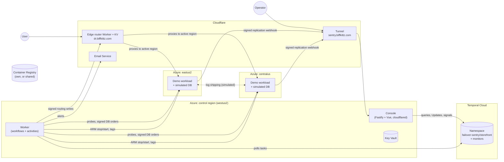
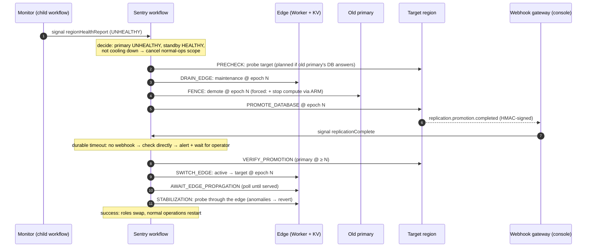

# Architecture

The Failover Sentry is a durable, autonomous orchestrator that keeps one protected service ("storefront") running in
one of several regions. It watches every region, decides when to fail over, moves the primary database and the edge
routing in a safe order, verifies the result, and moves everything back if anything looks wrong.

- [Components](#components)
- [Deployment topology](#deployment-topology)
- [The failover, step by step](#the-failover-step-by-step)
- [How split brain is prevented](#how-split-brain-is-prevented)
- [Consistency and propagation](#consistency-and-propagation)
- [Security model](#security-model)
- [Cost model](#cost-model)
- [Decisions and trade-offs](#decisions-and-trade-offs)

## Components

| Component | Code | Runs on | Role |
| --- | --- | --- | --- |
| **Sentry workflow** (`failoverSentryWorkflow`) | `apps/worker/src/workflows/sentry` | Temporal Cloud (state) + worker (code) | The singleton orchestrator: aggregates health, decides, runs failovers and compensation, keeps reality in line (reconciliation). |
| **Region monitors** (`monitorRegionChild`) | `apps/worker/src/workflows/monitor-region.ts` | Temporal + worker | One child workflow per region: probe → evaluate a rolling window → report changes to the sentry by signal. |
| **Worker** | `apps/worker` | Container App (control region) | Polls the task queue; runs the workflows and the activities (probes, signed DB orders, edge writes, Azure Resource Manager fencing, alert emails). |
| **Console** | `apps/console/server`, `apps/console/web` | Container App + `cloudflared` sidecar | Vue 3 SPA and its backend: GitHub sign-in, live state over Server-Sent Events, operator actions as Temporal Updates, chaos controls, and the **webhook gateway** that turns external confirmations into signals. |
| **Demo workload** | `apps/regional-app` | One Container App per region | The protected service: a storefront page, `/healthz`, a simulated primary/replica database with epoch fencing, chaos switches, and the replication webhook. |
| **Edge router** | `apps/edge-router` | Cloudflare Worker + KV | Proxies `dr.biffkittz.com` to the active region; refuses routing writes older than what it holds. |

## Deployment topology

- **Three regions.** The control plane (worker, console, Key Vault, logs) runs in `westus2`; the workload runs in
  `eastus2` and `centralus` (an Azure paired-region pair). An outage of either workload region can't
  take the sentry with it, and the sentry acts as a third-site witness: it fails over only when it sees the primary
  unhealthy *and* a standby healthy, so a sentry that loses its own connectivity does nothing.
- **The registry** is created in `westus2` too, or an existing one is shared: the demo environment uses login-app's
  (`centralus`).
- **Temporal Cloud** holds the workflow state; the worker holds no state and can be replaced any time.
- **No public origin for the console.** `cloudflared` dials out from the console's Container App; Cloudflare reaches
  the console only through the tunnel.
- **Regional apps have public ingress** on their `*.azurecontainerapps.io` host names: the edge proxies to them and
  the sentry probes them. Their admin API (`/internal/*`) requires an HMAC signature, and the edge never proxies it.

## The failover, step by step

If any step fails, an operator aborts, or stabilization sees anomalies, the sentry **compensates** in a
non-cancellable scope: if the old primary can serve it drains the edge, demotes the target, restores the old primary
under a *new* epoch and routes back (`REVERTED` / `ABORTED`); if the old primary can't serve, reverting would make
things worse, so it keeps the target if that is primary (`KEPT_TARGET`) or holds the maintenance page and requires
manual intervention (`MANUAL_INTERVENTION`, automatic failover suspended). See [WORKFLOWS.md](WORKFLOWS.md).

## How split brain is prevented

1. **One decider.** The sentry is a singleton workflow (one workflow ID per service); Temporal guarantees one
   execution, and its handlers and main loop run single-threaded. Monitors only report; they never decide.
2. **Order of operations.** Drain traffic → fence the old primary → promote → verify → route. Traffic never reaches a
   region whose database isn't the verified primary.
3. **Fencing tokens (epochs).** Every authority change increments the epoch. Database nodes refuse promotions and
   demotions older than the epoch they hold; the edge refuses routing writes older (by epoch, then write version)
   than what it holds. A stale sentry or a delayed retry of an old activity ("zombie") can't roll anything back.
4. **Self-fencing.** A database node that learns of a primary with a higher epoch demotes itself.
5. **STONITH.** During forced failovers the sentry stops the old primary's Container App through Azure Resource
   Manager, so a half-alive old primary can't keep accepting writes.
6. **Reconciliation.** In normal operations the sentry fences any non-active region that still claims to be primary
   (alert `SPLIT_BRAIN_FENCED`), establishes a primary if none exists, and re-syncs the edge if it drifted.

## Consistency and propagation

- **Workers KV is eventually consistent** across Cloudflare locations: data-path reads cache for at least 30 s, which
  is exactly the "propagation" the failover waits out (`AWAIT_EDGE_PROPAGATION` polls until the edge location it
  reaches serves the new routing). The fencing check in the Worker reads the freshest value at the location that
  serves the sentry's writes; together with Temporal's single writer and the (epoch, version) order this rejects
  stale writes in practice. A Durable Object would make the check globally linearizable; it was left out because
  Terraform's handling of Durable Object migrations is hard to keep idempotent.
- **The simulated database** replicates asynchronously: a forced promotion can lose the transactions the replica
  hadn't applied, and the webhook reports how many.
- **Probe data is a cache.** Monitors report on change (and periodically); the sentry's view of a region is as fresh
  as the last report, and decisions ignore verdicts from monitors that stopped reporting and, after a failover,
  reports observed before it ended (they describe the old roles).

## Security model

| Concern | Control |
| --- | --- |
| Console access | GitHub OAuth (PKCE, state cookie), allowlisted logins only; the GitHub token is revoked right after reading the profile. |
| Session | AES-256-GCM sealed, `HttpOnly`, `Secure`, `SameSite=Lax`, `__Host-` cookie; nothing in `localStorage`. Signing out deletes it with the same attributes (browsers ignore a `__Host-` deletion without `Secure`); a login removed from the allowlist loses its sessions at once. |
| CSRF | State-changing requests need the `x-sentry-csrf` header and a same-origin `Origin`/`Sec-Fetch-Site`. |
| XSS | Strict CSP (`script-src 'self'`, no inline scripts), no `v-html`, escaped server-rendered pages. |
| Service-to-service | HMAC-SHA256 signatures over method, path, body and timestamp (5-minute window), with key rotation lists. Admin orders name their region inside the signed body, so a captured order can't be replayed against a peer; epochs are capped, so a forged one can't wedge the fencing. |
| Regional admin API | The signature check belongs to the admin routes' own plugin scope, not to a URL prefix: the router decodes percent-escapes, so a prefix check (`/%69nternal/...`) can be bypassed. The edge refuses `/internal/*` however it is spelled. |
| Webhook gateway | Signature-verified, schema-validated, rate-limited; deduplicated by event ID in the workflow. |
| Secrets | Generated by Terraform or supplied via `TF_VAR_*`, stored in Key Vault; each identity reads only its own secrets. |
| Azure permissions | Managed identities only. The worker's custom role allows reading, starting and stopping Container Apps, plus Tag Contributor, scoped to the regional resource groups. |
| Network | The console has no ingress (tunnel only); regional admin APIs require signatures. |

## Cost model

Roughly **$15–35/month** in Azure at the defaults (registry ~$5, nothing when shared, consumption Container Apps mostly idle, Key Vault
and logs pennies), Cloudflare free-plan features, and Temporal Cloud usage: each probe costs about two actions
(local activity + timer), so two regions at a 30 s interval are ~0.35 M actions/month plus failovers. Lower the
cost by raising `health_policy.probe_interval_seconds`; speed up detection by lowering it.

## Decisions and trade-offs

| Decision | Why | Alternative considered |
| --- | --- | --- |
| Temporal Cloud | Production-grade service, nothing to run; matches the login-app project. | Self-hosting on Container Apps + PostgreSQL (~$40–60/month), or a dev server on a VM. |
| Simulated database | Free, fast to fail over repeatedly, fully observable; exercises the same workflow paths (planned/forced, webhook, stall, fencing). | Azure SQL Basic + failover group (~$10/month) with an Event Grid webhook. |
| Cloudflare Tunnel for the console | No public origin, no certificate, no zone-wide settings (Authenticated Origin Pulls, Origin Rules) that another project on the zone owns. | TCP ingress with the origin certificate (the login-app pattern). |
| Worker + KV for edge routing | Data path independent of the control plane; free; natural propagation semantics. | DNS record swaps (Host-header problems with Container Apps), Cloudflare Load Balancing ($). |
| Child workflow per region | Isolates each polling loop's history and failures; parent aggregates verdicts. | Polling in the parent (bloated history, one failure domain). |
| Local activities for probes | Frequent, short, cheaper in history and actions. | Regular activities. |
| Custom fencing role | Least privilege: read/start/stop only. | Built-in Container Apps Operator (also exec, log streams, every other action). |
| Sharing login-app's registry (demo environment) | Saves its ~$5/month; a Basic registry holds both projects' images easily. The cost: it lives in `centralus`, a protected region, and Basic has no geo-replication, so during a real `centralus` outage nothing could pull images (a restarted worker or console, a fenced region coming back). Running apps keep running, and this demo's outages are simulated. | This project's own registry in the control region (the default without `existing_container_registry`), or Premium with geo-replication for real DR. |
| Webhook + durable timeout + direct check | Webhooks get lost; a timeout alone would alert on every lost delivery. | Waiting on the webhook only, or polling only. |
