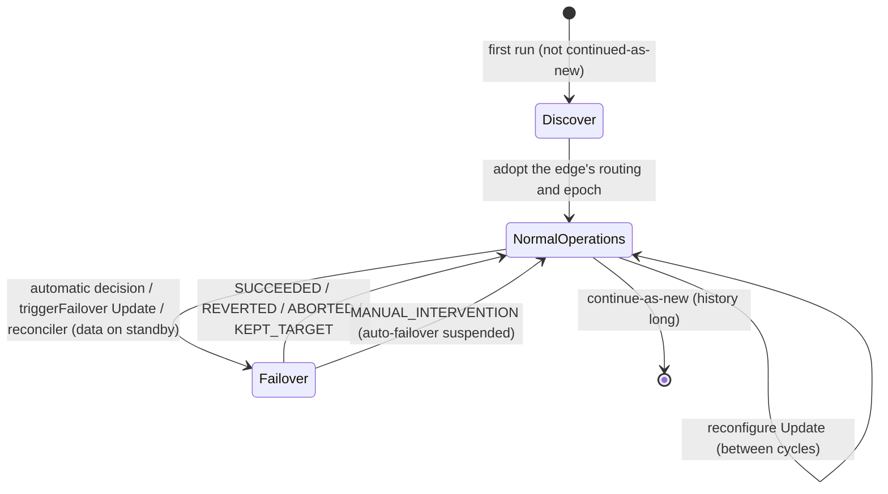

# The Temporal workflows

How the sentry uses Temporal's TypeScript SDK (1.26), and where each feature lives in the code.

- [Feature map](#feature-map)
- [The sentry's lifecycle](#the-sentrys-lifecycle)
- [Child workflows for regional isolation](#child-workflows-for-regional-isolation)
- [Cancellation scopes](#cancellation-scopes)
- [Signals, the webhook gateway and the durable timeout](#signals-the-webhook-gateway-and-the-durable-timeout)
- [Updates (operator actions)](#updates-operator-actions)
- [Compensation (saga)](#compensation-saga)
- [Activities](#activities)
- [History size and continue-as-new](#history-size-and-continue-as-new)
- [Determinism and versioning](#determinism-and-versioning)
- [Testing](#testing)

## Feature map

| Temporal feature | Where | What for |
| --- | --- | --- |
| Child workflows (`startChild`, `ParentClosePolicy`, `ChildWorkflowCancellationType`) | `sentry.ts` → `superviseMonitor` | One `monitorRegionChild` per region, supervised and restarted. |
| `CancellationScope` (cancellable) | `sentry.ts` → `runNormalOperations`, `runFailover` | Stop the normal-operations branch (monitors, reconciler, their timers) at once; let operators abort a failover. |
| `CancellationScope.nonCancellable` | `sentry.ts` → `runFailover`, `deliver` | Compensation and alert delivery finish even when the surrounding work was cancelled. |
| Signals | `regionHealthReport` (monitor → sentry), `replicationComplete` (webhook gateway → sentry) | Push facts into the sentry. |
| `condition(fn, timeout)` | `failover.ts` → `awaitReplication`, `sentry.ts` | Wait for a signal with a durable timeout. |
| Updates with validators | `triggerFailover`, `abortFailover`, `resolveStall`, `setAutoFailover`, `acknowledgeAlert`, `recoverRegion`, `reconfigure` | Synchronous, validated operator actions recorded in history with who did them. |
| Queries | `getSentryState`, `getMonitorState` | The console's live view (streamed as Server-Sent Events). |
| Local activities | `probeRegion`, `probeEdge` | Frequent, short probes. |
| Activity heartbeats + cancellation | `verifyEdgeRouting`, compute operations | Long polls that stop promptly when a failover is aborted. |
| Retry policies, non-retryable errors | `workflows/activities.ts`, `activities/index.ts` | Probes never retry; orders retry briefly; verifications poll via retries; fencing refusals are data. |
| `continueAsNew`, `continueAsNewSuggested`, `allHandlersFinished` | `sentry.ts`, `monitor-region.ts` | Bounded histories for workflows that never end. |
| `WorkflowIdConflictPolicy.USE_EXISTING` | `apps/worker/src/bootstrap.ts`, console gateway | Idempotent singleton start. |
| Prebundled workflow code | `apps/worker/src/scripts/bundle-workflows.ts` | Fast, reproducible worker start-up. |
| `@temporalio/envconfig` | worker and console `main.ts` | Standard `TEMPORAL_*` connection settings (Temporal Cloud API key). |

## The sentry's lifecycle

`runNormalOperations` starts a cancellable scope running two loops — the monitor supervisors and the reconciler — and
waits with `condition` until there is a reason to leave: a pending failover trigger, a pending reconfiguration, or a
long history. Then it cancels the scope and waits for everything in it to settle (`settleAll`, not `Promise.all`:
every monitor child must have finished cancelling before its workflow ID is reused).

## Child workflows for regional isolation

Each region's polling loop is a child workflow, `failover-sentry/<service>/monitor/<region>`:

- It probes with a **local activity** (no retries: a failed probe *is* the measurement), keeps a rolling window, and
  evaluates it with the pure `evaluateHealth` (`domain/health.ts`).
- It **signals the sentry only on change** (status, or database role/epoch/promotion) and periodically, so the parent's
  history stays small and the parent aggregates verdicts, not raw probes.
- It **continues as new** every 300 iterations (or when the server suggests), carrying its window.
- The console queries it directly (`getMonitorState`) for the probe history.
- `ChildWorkflowCancellationType.WAIT_CANCELLATION_COMPLETED` makes cancellation complete only when the child has
  really stopped; `ParentClosePolicy.REQUEST_CANCEL` stops orphaned monitors if the sentry is terminated.
- A child's cancellation targets the run the parent started, and a monitor that has continued as new is no longer
  that run: the cancellation would never arrive, and the wait above would never end. So before cancelling the scope
  the sentry cancels each started monitor by **workflow ID alone**, which reaches the current run of its chain
  (`stopMonitors`).
- A supervisor restarts a monitor that ends or fails, with backoff; if an old monitor with the same ID is still
  running (after a reset), it is cancelled first.

## Cancellation scopes

Three uses, each a deliberate choice:

1. **Normal operations** run in `new CancellationScope()`. A trigger (an automatic decision in the
   `regionHealthReport` handler, the emergency failover Update, a reconfiguration) makes the main loop cancel it:
   the monitor children, the reconciler's sleeps, and any activity in flight are cancelled together. No timer
   survives into the failover branch.
2. **The failover** runs in its own cancellable scope. The `abortFailover` Update calls `scope.cancel()`: whatever the
   failover awaits — an activity, a durable timer, the replication wait — rejects with `CancelledFailure`
   immediately, and heartbeating activities learn of it on their next heartbeat.
3. **Compensation and alert delivery** run in `CancellationScope.nonCancellable`, so an abort can't interrupt the
   cleanup it triggered, or swallow the alert that reports it.

## Signals, the webhook gateway and the durable timeout

When the target database finishes its promotion, the region POSTs an HMAC-signed `replication.promotion.completed`
(or `.failed`) event to the console's webhook gateway (`apps/console/server/src/routes/webhooks.ts`). The gateway
verifies the signature, validates the body, and signals `replicationComplete`; it answers 202 only once Temporal
accepted the signal, so the sender retries otherwise (at-least-once). The sentry deduplicates by event ID and ignores
events for another failover, region or an older epoch.

The failover waits with `condition(() => run.replication !== null, replicationTimeoutSeconds)` — a **durable timer**
in Temporal, surviving worker restarts. On timeout:

1. It **checks the database directly** (webhooks get lost). Promoted → proceed with a `REPLICATION_WEBHOOK_MISSING`
   warning.
2. Otherwise it raises **`REPLICATION_STALLED`** (critical; emailed) and waits for the webhook or an operator
   decision (`resolveStall`: keep waiting, retry as a forced promotion under a new epoch, or abort), bounded by
   `stallEscalationSeconds`, after which it checks once more and reverts.
3. After a decision it goes back to waiting for the webhook with a fresh durable timeout.

## Updates (operator actions)

Updates are synchronous and validated *before* they are recorded: a validator that throws rejects the Update without
touching history (e.g. "A failover is already in progress", "A planned failover needs a HEALTHY target"). Each handler
records the operator's GitHub login in the timeline. `triggerFailover` returns once the failover branch has taken over
(normal operations stopped), with the failover ID and epoch; the console then follows it over the state stream.

## Compensation (saga)

`FailoverExecution` records which side effects it attempted (edge drained, old primary fenced, promotion requested,
edge switched). `compensate` (non-cancellable) chooses:

| Old primary can serve? | Target promoted? | Action | Outcome |
| --- | --- | --- | --- |
| yes | any | drain edge, demote target, restore old primary under a **new** epoch, route back | `REVERTED` / `ABORTED` |
| no | yes | keep the target, make sure the edge routes to it | `KEPT_TARGET` |
| no | no | hold the maintenance page, suspend automatic failover, alert | `MANUAL_INTERVENTION` |

Each compensation step is attempted independently and recorded (`run.compensations`), so a failure in one doesn't
hide the others.

## Activities

Activities take region IDs, never URLs; the worker resolves them from its own configuration (no SSRF through
workflow input). Error policy: transient failures throw plain errors (retried); failures a retry can't fix throw
`ApplicationFailure.nonRetryable`; fencing refusals (`409 stale_epoch`) are returned as data because the workflow
decides what they mean (adopt the higher epoch, or fail the step).

| Activity | Kind | Retry |
| --- | --- | --- |
| `probeRegion`, `probeEdge` | local | none |
| `getDatabaseStatus`, `demoteDatabase`, `requestDatabasePromotion`, `getEdgeRouting`, `setEdgeRouting` | regular | 4 attempts, 1–10 s backoff |
| `verifyDatabasePrimary` | regular | polls through retries for up to 3 minutes |
| `verifyEdgeRouting` | regular, heartbeating | one long attempt (+1) |
| `stopRegionCompute`, `startRegionCompute`, `tagRegionRoles` | regular, heartbeating (Azure Resource Manager) | 3 attempts |
| `sendAlert` | regular | up to 10 minutes |

## History size and continue-as-new

The sentry never ends. It continues as new when the server suggests it (or past 20 000 events), between
normal-operations cycles, after waiting for `allHandlersFinished()` and for background tasks (alert deliveries,
recoveries). A failover or reconfiguration requested during that wait can't finish before the main loop serves it,
so the sentry defers continuing as new and serves it first (`CONTINUE_AS_NEW_DEFERRED` in the timeline) instead of
waiting for it forever. It carries everything that matters: epoch, active region, edge routing, region health and
compute, when the last failover ended, recent failovers, alerts, timeline, processed webhook event IDs and its ID
sequence.

## Determinism and versioning

Workflow code uses only workflow time (`Date.now()` is deterministic inside workflows), `sleep`, `condition`,
deterministic IDs from a carried sequence, and pure functions from `domain/`. ESLint forbids timers, `fetch` and
Node.js modules in `src/workflows/**`.

**Changing workflow code that is already running** (in Temporal Cloud) must keep replay deterministic: guard changes to
the order or kind of activities, timers and child workflows with `patched('change-id')`, deploy, and remove the old
branch only once no running history needs it. Local stacks can simply be reset (`docker compose down -v`).

Patches in use (`sentry/sentry.ts`):

| Patch ID | What it changed |
| --- | --- |
| `fresh-health-after-failover` | After a failover ends, decisions ignore health observed before it (no false split brain on the old primary's last "primary" report). |
| `cancel-monitors-by-workflow-id` | Monitors are cancelled by workflow ID before the normal-operations scope, so one that continued as new still stops. |

## Testing

- `apps/worker/test/domain`: the pure decision logic (health windows, target choice, automatic decisions,
  reconciliation plans).
- `apps/worker/test/adapters`: signed HTTP clients against local servers, fencing refusals, Cloudflare challenges,
  the email payload.
- `apps/worker/test/workflows`: fifteen end-to-end scenarios against the Temporal CLI's dev server with a fake world
  (`test/helpers/fake-world.ts`): bootstrap, automatic failover with fencing, manual planned failover (and no false
  split brain after it), a second failover refused while the first takes over, validator rejections, stall → abort,
  stall → retry as forced, missing webhook, in-flight abort, stabilization anomaly → revert, duplicate/stale
  webhooks, split-brain fencing, suspended automatic failover. Two more run on a server that suggests continuing as
  new after 150 events: failing over once the monitors have continued as new, and a failover requested while the
  sentry waits to continue as new.
